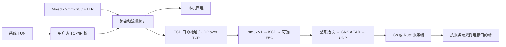

# CS2World 纯 Rust 核心 · 阶段 0 架构设计

**审阅稿 · 2026-11-21**　协议基线 v0.0.1，Go 仓库提交 `ea7b5e100d898c8a67a25babe2be608652fbcc89`。Windows 客户端取本地工作树。本次交付是设计、字节规范与旧实现的验证结果。阶段 1 由维护者确认这份设计后开始。

**建议在仓库根目录建立 Cargo workspace，把现有 Win32 工程原地纳入。** 第一项实现先证明 Rust 和 Go 能在两个方向传输同一条 TCP 流和同一组 UDP 数据报，再迁移产品入口。协议裁判选用原生 `type: cs2world` 的 sing-box 适配器。另一套 `cmd/cs2-ghost` 将每条流直接转到配置里的固定 TCP 目标，流首语义不同。[逐字段协议对照与 URI 样例](2026-11-21-cs2world-wire.md) · [Go 入站](../../../pkg/cs2world/inbound.go) · [Go 出站](../../../pkg/cs2world/outbound.go) · [固定目标入口](../../../cmd/cs2-ghost/main.go)

## 1. 迁移依据

| 会影响实现的事实 | 设计决定 |
|---|---|
| GNS 外观下是项目自定义的握手与 AEAD。握手 MAC 有前缀，三个派生值有各自的 HMAC 标签。 | 固定已发布 v0.0.1 的字节。按同输入比较测试向量，两端生产环境仍各自使用安全随机数。 |
| 业务 UDP 先进入 UoT v2，再作为 smux 字节流经过 KCP、可选 FEC 和 GNS。 | 核心区分 TCP 流与保留边界及来源地址的 UDP 数据报。验证 SOCKS5 UDP 回显与多目标应答。 |
| 真实报文立即发送。配置的 64 Hz 对应的 15.625 ms 计算函数没有驱动发送。只有客户端定时器每 46 ms 查询空闲状态。 | v0.0.1 复现实际节拍、阈值和包长分布。另行变更节拍需要新的行为配置及对照数据。 |
| RULES 会反复得到 challenge。INFO 可直接查询，PLAYER 有列表。 | 协议测试分别检查三种查询。界面上的 A2S 成功只代表 INFO 响应可解析。 |
| Go 裸配置缺省 FEC 关闭、整形关闭；分享链接的缺省是 10:3、整形开启。 | 分开解析配置来源。尤其要显式保存关闭 FEC 的节点，避免导出再导入时启用。 |
| 旧客户端启动时同步运行配置检查，并等待子进程 350 ms；连上后每秒读 Clash API。 | 后台启动运行时，GUI 接收状态与统计快照。保留 Win32/GDI、托盘、节点、导入导出和系统代理入口。 |

代码依赖按本地 `go.mod`、`go.sum` 与实际模块缓存核对，包含 `xtaci/kcp-go/v5 v5.7.6`、`klauspost/reedsolomon v1.14.2`、`xtaci/smux v1.5.60`、`sagernet/sing v0.9.7-0.20261023115459-5dc452e537bf` 和 `sing-box v1.14.4`。Go 兼容工作流固定此提交与模块校验和。升级上游时另跑同一组向量及双向互通，通过后再更新基线。[依赖清单](../../../go.mod) · [模块校验和](../../../go.sum)

本地 `win32-xp/` 在审读时尚未由 Git 跟踪。用于定位本次快照的 SHA-256 为 `core_manager.rs=f2633029b431d5e37ccc0c29a3443b4242a7cdbb9c2340923ba060c811d70387`、`uri.rs=e8154fe5e9a1de97ea6e00310a4323f167837562076f299a973580cbc3358744`。后续 CI 接入时应把需要的源码、资源与锁文件纳入版本控制。[原生客户端](../../../win32-xp/Cargo.toml) · [控制器](../../../win32-xp/src/core_manager.rs)

## 2. Workspace 与包边界

根虚拟 workspace 的好处是 `win32-xp` 保留原路径，四个 crate 和 GUI 可共用依赖解析及 release profile。独立 `rust/` 子 workspace 也能通过 path 依赖嵌入 GUI，但两个根要同步锁文件、编译配置和版本。此次建议前者。按阶段加入实际存在的成员，以核心包作默认成员。Windows GUI 只在 Windows 作业中构建。现有 Tauri 工程 `app/src-tauri` 显式排除，独立管理。Go 的构建入口及发布标签继续供可选 sing-box 适配使用。[Cargo 工作空间规则](https://doc.rust-lang.org/cargo/reference/workspaces.html)

```text
Cargo.toml, Cargo.lock                  根 workspace、统一 release profile
crates/cs2world-proto/                 无 I/O 的协议状态机
crates/cs2world-core/                  Tokio 客户端、服务端与平台接口
crates/cs2world-server/                Linux 服务端 CLI
crates/cs2world-ffi/                   C ABI、Swift 桥接、Android JNI
win32-xp/                              直接依赖 core 的原生程序
tests/interop/                         锁定的 Go 对照、向量、回环测试驱动（拟建）
pkg/, cmd/sing-box-cs2world/            Go 参考与可选适配器
```

| 包 | 所有权与接口 | 依赖约束 |
|---|---|---|
| `proto` | 拥有握手、密钥、序号、重放窗口、KCP、FEC 分组、smux、目标地址、UoT、A2S、整形和 URI。输入切片、时刻、随机源，输出待发送报文、流事件及下次定时器到期时刻。 | 基础目标 `#![no_std]` + `alloc`，全协议功能在裸目标做编译检查。KCP/RS 优先使用满足向量的纯 Rust 实现；缺少准确包头、矩阵、流模式或 no_std 支持时在本包适配或移植该层。密码原语使用 RustCrypto AES-GCM/HMAC/SHA-256 与 x25519-dalek；不自行实现原语。 |
| `core` | 单一运行时管理网络、计时和任务。给入口提供 `open_tcp(target)`、`open_udp(association)`、配置校验、启停、重载、快照和订阅；服务端共享协议驱动并拥有出站拨号器。 | Tokio 仅开启使用的网络、调度、同步、计时功能。Smoltcp 和设备后端由 TUN 特性引入；平台系统调用收在 `cfg(target_os)` 模块。 |
| `server` | 极薄的参数、配置、信号及日志层。运行态由 `core` 创建。 | 面向 Linux x86_64、aarch64 的 musl 静态目标；默认服务端构建不引入 GUI/JNI/TUN。 |
| `ffi` | 生命周期句柄、C 头文件、状态与日志回调；Android JNI 委托同一安全 Rust API。 | Swift 用静态库/XCFramework；Android 产各 ABI 的 `.so`。Windows GUI 直接调用 Rust，不经过 FFI。 |

`proto` 把 Unix 秒、本地小时与单调时钟分别传入，分别用于握手校时、A2S 人数及传输调度。运行时独占安全随机源，整形采样器独立；测试注入固定输入。协议层的可变状态按会话单一拥有者串行推进，产生的网络写入由驱动完成。FEC 缓冲按组按需分配，smux 队列按字节计预算；取消流、关闭会话、设备切网均释放配额。CI 同时检查 `cargo tree -e features`、纯 Rust 算法依赖和裸目标编译。系统 socket、随机数、驱动和平台 ABI 由操作系统提供。



握手、A2S 查询与回复直接使用外层 UDP。空闲 dummy 经过 GNS 加密，在接收端送 KCP 之前消费。服务端使用同一 UDP 监听器按上述类别分发，配置需区分公共 UDP 监听端口与客户端本地 Mixed 端口。

## 3. 运行时、路由与配置

**Mixed。** 默认地址为 `127.0.0.1:17890`（Win32 设置），导入 JSON 时使用其 `listen/listen_port`。读取足够的首部后按 SOCKS5 或 HTTP/1.x 分流，保留先读到的业务字节。SOCKS5 支持无认证 CONNECT 和 UDP ASSOCIATE，返回实际绑定地址。UDP 包格式为 `RSV[2]=0 | FRAG=0 | ATYP+ADDR+PORT | DATA`，按控制连接与客户 UDP 端点绑定关联，控制连接关闭即回收。对不支持的 SOCKS 命令返回明确状态，分片按 SOCKS 规则丢弃。HTTP 代理把 absolute-form 请求转为目标 HTTP 请求，处理 Content-Length/chunked、持久连接与逐跳首部；HTTPS 通过 CONNECT 建立端到端 TLS 隧道，保留 CONNECT 后同一读缓冲中的 ClientHello。这里采用现有 WinINet 使用的明文本地代理端口；若产品要求客户端先向代理端口建立 TLS，需单列证书配置与 TLS 入口验收。[现有 Mixed 配置](../../../win32-xp/src/singbox_config.rs) · [现有出口检测](../../../win32-xp/src/probe.rs)

**路由。** `direct` 全部直连。`global` 沿用 Win32 的私网直连、其余走节点。`rule` 在可选用户规则后应用私网和域名后缀规则，再走节点。自定义项按声明顺序首次命中，匹配精确域名、标签边界后缀、IPv4/IPv6 CIDR，可限制 TCP/UDP，动作 `direct/proxy/block`。客户端内置后缀 `.cn/.local/.lan`，比较前折叠大小写并去掉结尾点，`badcn` 不匹配 `.cn`。IP 判定对齐锁定的 `sing/common/network/addr.go::IsPublicAddr` 的反集，包括私有、环回、组播、链路本地和未指定地址。先规整 IPv4-mapped IPv6。私有地址规则与自定义规则优先级写入匹配测试。

**解析与防回环。** Mixed 已给出域名时保留原目标；代理域名由服务端解析，直连域名由本地解析。TUN 只有 IP 时先使用 IP 规则，有已验证的 DNS 关联或可解析的 HTTP Host/TLS SNI 时补上域名规则，遇到多个域名共享 IP 不能仅凭缓存猜域名。需要可靠按域分流的 TUN 请求通过系统指定的 DNS 入口收集匹配信息；不可识别的流按 IP/默认规则。节点自身域名用独立的系统引导解析器，传输 socket、直连 socket 及引导 DNS 经物理接口。隧道建立前先安装必要的端点路由或 socket 保护，接口变化时重选出站接口。服务端按服务端配置独立判定目标，含域名解析后的实际 IP；校验通过的 IP 用于本次拨号。

**启动和热重载。** `Stopped → Starting → Running → Stopping → Stopped`；启动失败发出包含原因的 `Failed` 并释放已取得的资源。监听就绪、隧道认证成功分别发事件，GUI 区分“代理已就绪”和“节点已连接”。Go 出站按需建隧道，Rust 核心支持按需复用和显式预连接，以供 GUI 给出确切连接状态。多条并发流共享一次在途握手。本地绑定或 DNS 失败、等待握手超时、收到未认证的拒绝帧、握手认证成功分别报告。多种远端条件返回同一拒绝帧，只能把密钥不匹配列为可能原因。单任务串行管理配置代际；先验证候选，再准备资源，同地址复用监听器；资源准备失败时继续使用上一个可用配置。路由变化影响新流，节点或密钥变化为新流建立新会话，旧流限时排空。为同一服务端并建替代隧道时，先绑定新的本地 UDP 端口。Go 对端的 GNS 反向索引和 KCP listener 都按源端点查找，复用同一源端点会使新会话覆盖旧流。换网时重建传输；失去旧网络的存量流以断开事件结束。关闭幂等，取消接收与定时器并等待回收；意外断链重连有版本标记和退避，旧任务不得覆盖新连接状态。

**统计。** 每个方向分别累计业务载荷字节和外层线上 UDP 字节，连接数单列 TCP 流及 UDP 关联。UI 延用 `up_total/down_total` 作为本次连接的业务总量，速率是单调时钟采样的 B/s；线速计数含 FEC、ACK、dummy 和控制包。统计快照可合并至约 1 Hz。状态变化即时送达，慢订阅者可重新读取最新状态。日志有界并脱敏，A2S 探针独立于连接生命周期。FFI 与 GUI 读取同源快照。

**JSON 兼容范围。** 产品入口识别原生 `inbounds/outbounds` 封套中的 `cs2world`、`mixed`、`direct`、部署脚本的 `block`、`route.final/rules`、基础 `log`，以及 GUI 使用的 `auto_detect_interface`。映射 `tag/listen/listen_port/server/server_port/psk`、五个 KCP 字段、五个 shaper 字段和五个 A2S 字段。配置按“缺省/显式零/显式假”解码，先应用来源对应的缺省再校验。导入其他 sing-box 协议或涉及拨号、DNS、路由和访问控制的未实现字段时，`check` 指出 JSON 路径。部署模板的服务端 `ip_is_private → block` 必须在 TCP、每个 UDP 目的端及 DNS 解析结果上生效；仓库基础服务端示例只有 direct，回环互测使用该示例。固定目标 `mode/listen_addr/target_addr` 和 VLESS 示例在工具中标识为独立 profile，主线互通测试采用原生封套。[配置定义](../../../pkg/cs2world/options.go) · [客户端例](../../../configs/cs2world_client.json) · [服务端例](../../../configs/cs2world_server.json) · [实际部署模板](../../../scripts/cs2world-deploy-v0.0.1.sh)

## 4. Windows、macOS、Android 和服务端交付

| 入口 | 集成及资源归属 | 验收重点 |
|---|---|---|
| Win32 系统代理 | `CoreController` 持有后台命令发送端与只读快照。窗口线程用 `PostMessageW` 通知有事件可取；事件数据由受控队列持有。沿用界面、托盘、剪贴板、多行/Base64 节点导入与 `data/state.json`。旧 `clash_port` 可读，内嵌模式收起该设置。 | 在空目录仅放 `CS2World-XP.exe` 启动，可创建用户数据。无外部核心进程、无 Clash 监听。用不可达节点、在线换节点、连续启停压测窗口消息响应。 |
| Windows TUN | 阶段 4 接入 Wintun 会话、收发环、路由及 DNS 资源。建议单 EXE 内嵌对应架构的官方签名 DLL，首次启用时校验并在私有目录安全展开、按绝对路径加载；仅此模式需要驱动与相应权限。 | 分别测“单文件分发”和“运行时使用签名驱动”。阶段 3 先交付系统代理预览；尚不可用的 TUN 在 UI 明示阶段状态。阶段 4 验证覆盖安装、取消提权和回滚。[Wintun 分发及接口](https://www.wintun.net/) |
| macOS | `TunDevice` 接受标准 L3 数据包。原生 utun 适配器负责控制 socket、包头地址族与收发；Swift 通过 C ABI 启停。受管应用通过 Network Extension 的 `packetFlow` 交接 IP 包，配置路由、DNS 与 MTU。阶段 4 默认交付签名条件允许的原生应用，分别测原生 utun 与系统扩展入口。 | x86_64/arm64 构建、Swift 调用、utun 数据面、取消和恢复。系统扩展分发另需用户的签名身份与 Network Extension entitlement。[Apple utun](https://raw.githubusercontent.com/apple-oss-distributions/xnu/main/bsd/net/if_utun.h) · [Apple Packet Tunnel](https://developer.apple.com/documentation/networkextension/nepackettunnelprovider) |
| Android | Kotlin 的 `VpnService` 请求同意，`Builder.establish()` 得到 TUN，JNI 接收借用 fd 并同步复制为 Rust 独占的 fd；Java 管理其原始描述符。每个需绕开 TUN 的 socket 在连接/发送前由 `protect(fd)` 处理。 | arm64-v8a 真机与 x86_64 模拟器；覆盖授权拒绝、系统撤销、Wi-Fi/蜂窝切换和重复 stop。记录线程及 fd 数回归。[Android VpnService](https://developer.android.com/develop/connectivity/vpn) |
| Linux server | `cs2world-server check -c FILE`、`run -c FILE`、`version`；SIGTERM 停机，SIGHUP 重载。沿用已校验配置再切换、systemd 管理和版本化回滚思路。Go 和 Rust 用独立二进制名和发布路径。 | 两个 musl 架构都用 `readelf -lW/-dW` 检查无动态解释器和 NEEDED，并在各自架构实际完成回环。记录空闲与并发下 RSS、线程数、p50/p99 延迟、吞吐；实际给出数字。[旧部署入口](../../../scripts/cs2world-deploy-v0.0.1.sh) |

**TUN 数据面。** 所有设备后端执行整包 L3 读写，统一暴露 MTU、IP 版本、取消和关闭。Rust 用户态栈处理 TCP 序号、ACK、FIN、重传，维护五元组、原目的地址与有界缓存。只在新 SYN 时创建目标流，背压传到 TCP 窗口；UDP 按来源及目的端关联、超时回收，同一应答回写正确五元组。连接阶段已消费的首批数据按序转发。设备 MTU 与 KCP MTU 独立。内存设备测试驱动 SYN/ACK、半关闭、DNS UDP 和 IPv6 应答，真机用同一用例检查截获、端点旁路及路由恢复。Windows 服务模式可选，服务拥有设备和运行时，用户会话保留 GUI 与系统代理设置。Windows UDP 处理应保留参考实现对 ICMP 不可达和过长报文的行为。设置 `SIO_UDP_CONNRESET=false`，对已打开 socket 的暂态 10054/10040 分类后继续接收。[Go Windows socket 处理](../../../pkg/transport/udp_windows.go)[smoltcp 接口和 socket 分层](https://docs.rs/smoltcp/latest/smoltcp/)

**FFI 契约。** 导出版本化 `cs2w_*` C 符号，另提供 `create/destroy`。句柄使用受同步保护的整数 ID；`start/stop/reload/probe_a2s` 复制输入并排队，返回命令 ID/错误码；`get_stats` 将 `repr(C)` 的定宽数字写入调用者给出的带 `size/version` 缓冲。`on_log/on_event` 的回调在专用派发线程执行，字符串以 UTF-8 指针+长度借用至回调返回；避免跨分配器释放。注销后提供排空完成通知，`destroy` 在回调线程外等待排空，重入时返回明确状态。JNI 持有 JavaVM 和所需 global ref，在派发线程 attach，事件由应用转到主线程，完成停机后解除引用。所有边界检查指针、长度与句柄，禁止 unwind 穿过 ABI。阶段 4 交付 C 头文件、Swift 包装、JNI 签名、最小可启动的 macOS/Android 客户端和打包脚本。

**Win32 回归。** 用户点标题栏关闭时主窗口隐藏到托盘；真正退出时才清理。网络、配置持久化、探针及重连全部移出窗口回调。系统代理仅在本实例成功获取快照后修改，失败按快照逐项回滚，恢复后重复关闭不再写注册表。原 `connect → disconnect_internal → disable_system_proxy` 在无快照时会把 `ProxyEnable` 设为 0，这条旧路径会覆盖用户预设，必须有专门回归用例。`XP` 依照现有 manifest 指界面风格；首轮验证目标为当前 Win32/MSVC 桌面环境。阶段 3 在根 release profile 沿用 LTO、strip、单 codegen unit 并裁减特性，公布未压壳 EXE 字节数、依赖与构建命令。2–4 MB 是待实测的体积目标。[窗口过程](../../../win32-xp/src/main.rs) · [系统代理](../../../win32-xp/src/sysproxy.rs) · [程序清单](../../../win32-xp/app.manifest)

## 5. 验证与放行

### 阶段 0 已运行的基线

在仓库根目录执行。主机为 Windows x86_64，Go 1.27.1，Rust/Cargo 1.95.0。Windows 回环 E2E 使用工作树随附的 Go 二进制，其 SHA-256 为 `87acc2e535d802bb8b84764d6a6d179152f88b55720c26fe960b069400f2ff47`，其 Go 构建元数据为 `vcs.revision=e85149c6e297722d0045e58b8ea49086c2f2b38c`、`vcs.modified=true`，应与文首源码基线分别记账。旧 GUI release 文件为 762,368 B，外部 `sing-box.exe` 为 59,609,600 B，仅用来比较迁移前的分发构成。

另从本地仓库做独立 `git clone --no-hardlinks --no-checkout`，在临时检出中执行以下命令。产物的 `vcs.revision` 是文首完整提交，`vcs.modified=false`，SHA-256 为 `1b9e1a060fec11928e96dc6b566026bf47c525177f80c17dbe95e90f749dccae`，大小 44,762,112 B。此 Go 构建通过原版 Windows 回环 E2E 的 **7/7** 项，并通过同一 UDP 关联向两个目的端发送的 **6/6** 份报文检查。7/7 可用下列 PowerShell 命令复现，额外的业务 UDP 抽查使用临时驱动。

```powershell
git checkout --detach ea7b5e100d898c8a67a25babe2be608652fbcc89
$env:GOTOOLCHAIN = 'go1.27.1'
$env:GOWORK = 'off'
$env:CGO_ENABLED = '0'
go build -mod=readonly -trimpath -tags 'with_gvisor,with_quic,with_wireguard,with_utls,with_clash_api' -ldflags '-s -w -X github.com/sagernet/sing-box/constant.Version=1.14.4-cs2world-0.0.1' -o ./dist-v2rayn-win/sing-box.exe ./cmd/sing-box-cs2world
go version -m ./dist-v2rayn-win/sing-box.exe
python dist-v2rayn-win/test-local-v2rayn.py
```

| 可重复执行的检查 | 本次结果 |
|---|---|
| `go test -count=1 ./pkg/...` | protocol 用例通过；a2s、transport、shaper、cs2world 四包没有 Go 单测。 |
| `go test -mod=readonly -count=1 -run '^(TestFECEncodeConsecutive\|TestFECDecodeLoss\|TestFECDecodeVariablePacketSizes\|TestFECPAWS\|TestFECRTOAndSkipParity\|TestSetMtuBoundary)$' github.com/xtaci/kcp-go/v5` | 锁定模块的六项测试通过，含变长纠删、序号回绕、跳过 parity 及 MTU 边界。 |
| `go test -mod=readonly -count=1 -run '^(TestStreamID\|TestHalfCloseBasic\|TestHalfClosePreservesUnreadData\|TestSessionOpenAccept)$' github.com/xtaci/smux` | 锁定 smux 的四项测试通过，含 FIN 后保留未读数据。 |
| `python dist-v2rayn-win/test-local-v2rayn.py` | 旧 Go↔Go 的 7 项检查全部通过，含 A2S、拒绝响应、HTTP 请求及 256 KiB 下载 SHA-256。 |
| `cargo test --manifest-path win32-xp/Cargo.toml --locked --offline` | 原生客户端测试目标编译并退出 0，现有 Rust 单测为 0。 |
| `python scripts/cs2world-link.py decode 'cs2world://p%40ss-._~@[2001:db8::1]:27016?ds=4&ps=1&shaper=0#HK%20Lab'` | Python 正确还原 IPv6、PSK、备注、FEC 4:1 和禁用整形。 |

补充一次性回环实测复用了上述 Go 环境，分发件测一个回显端点；干净检出构建测两个回显端点。在同一 SOCKS5 控制连接及 UDP socket 内，向每个端点各发 7、512、1200 B，并让两个端点逆序回应。按报文独立核对了来源地址、端口和逐字节载荷。阶段 1 将它固化为双向 CI 用例。固定密钥下的两方向 Go AEAD 完整数据报已用另一实现逐字节复算，10:3 FEC 校验分片也已取出参考值。附录另有实调 Python 与原 Win32 URI 代码的互读、精确导出样例。本阶段没有 Rust 协议端点；跨语言字节等价、线上节点连接和新产物大小都须在后续报告中单独举证。[Windows 回环脚本](../../../dist-v2rayn-win/test-local-v2rayn.py) · [现有 Go 单测](../../../pkg/protocol/gns_test.go)

### 阶段 1–4 验收矩阵

以下入口和测试产物是待实现的交付物。每个阶段须给出可从干净检出重复执行的命令、非零失败退出码、实际工具链及报告。Go 构建器、向量生成器和本机测试代理只作为测试依赖。

| 阶段 | 将交付的自动化入口 | 必须观察到的结果 |
|---|---|---|
| **1 · proto** | `cargo test -p cs2world-proto --locked`；`cargo check -p cs2world-proto --no-default-features --target thumbv7em-none-eabi --locked`；`python tests/interop/run.py --matrix go-rust,rust-go` | 固定时间、临时密钥、序号、熵与填充的 Go 参考向量覆盖两方向，遇错返回偏移和层名。Rust 仅用测试端点驱动真实 UDP 与 TCP/UDP echo，不提前依赖 Mixed 产品入口。两角色均覆盖 FEC 关闭、10:3、非默认组、重排/丢片、多个并发流、IPv4/IPv6/域名、固定/多目标 UoT。单项条件见下文。 |
| **2 · core/server** | `cargo test -p cs2world-core -p cs2world-server --locked`；同一驱动增加 `--suite mixed,server`；两架构 release 构建。 | 真实 Mixed 端口过 HTTP GET/POST、HTTPS CONNECT、SOCKS5 TCP/UDP，多目的端并行回应；直连/代理/阻断按选定出口和统计核对。坏配置、端口冲突、重载失败、关闭后的端口重用有断言。同一节点重载时核对两条隧道的源端口与旧流排空；Linux 两种静态产物、systemd 生命周期、内存与延迟报告。 |
| **3 · Win32** | Windows 构建和 `--suite win32` UI 驱动；远端实测通过显式私密参数指定维护者的节点。 | 单文件空目录启动、导入旧 state/分享链接，代理前后快照一致。回环与实测节点分别验证认证、TCP、UDP；把节点信息从日志遮蔽。注入超时和 256 KiB 下载时同步投递窗口消息，记录 UI 响应 p95、p99 和最长间隔。建议初始门槛 p99 ≤100 ms、单次 ≤250 ms，记录系统和负载。给出实际字节数。 |
| **4 · 平台** | `--suite tun,ffi`、C/Swift 调用测试、Android instrumentation、各平台打包命令。 | 内存 TUN 与 Windows/macOS/Android 实际设备分别过 TCP、UDP、DNS、IPv6、断线恢复；FFI 在并发启停、重载、取消回调后无悬空引用或泄漏。提供各架构包的哈希、签名和所用设备/系统版本；可选 SCM 服务单列。 |

阶段 1 的**字节对照**在固定输入上逐字节比较握手、AEAD 双向、KCP 段、变长 RS parity、smux 与 UoT，来源为锁定 Go 代码的输出。Go 中未导出的编码器可在测试临时副本用同包测试访问，保持生产参考树独立；为密码学测试注入固定私钥与时间，记录完整向量，并让未插桩的 Go 程序参加黑盒网络互测。动态的 ID、时刻、随机名单、填充与定时器单列语义断言，避免把随机差异当作协议偏移。

阶段 1 用两种真实拓扑。Rust 客户端测试入口对接 Go 原生 `cs2world` 入站，再由 Go 路由到测试目标；Go 客户端通过其 Mixed 入站对接 Rust 测试服务端。两边都支持地址前导、TCP 半关闭和 UoT 多目标回显。单目标 UoT 用直接调用锁定 Go `uot.Client.DialContext(udp)` 的驱动覆盖，避免只测到 `ListenPacket` 路径。每次 CI 从指定源码构建 Go 对照，记录 Go 提交、模块校验和与二进制 SHA-256；无 Go 依赖的发布作业独立运行。

**防止假阳性。** 两个角色各自强制经过节点，客户端直接连接测试入口，使用仅服务端可到达的目标或服务端计数，并用停止参考端作失败对照。TCP 收发校验短消息、256 KiB、半关闭与并发流；UDP 在同一关联里请求两个目标，校验返回来源、逐报文边界和载荷。FEC 在编解码边界故意丢数据分片并验证由 parity 恢复，另用确定种子的网络损伤测试超过纠删能力后 KCP 重传。A2S 验证 INFO、PLAYER 两步及 RULES 重复 challenge。整形在受控时钟下测 35/46/250 ms 与 sleep 边界，在真实 socket 上统计时间及长度；不要求操作系统按精确纳秒调度。协议 MAC 负例重新签署过期时间戳，重放与伪造序号分别测。旧 Go 单测直接改时间戳后未重签；该用例单独不能证明校时窗口生效。

**待确认的设计取值。** 建议按文中的根 workspace、原生 sing-box 线协议、兼容旧节拍与 A2S 行为、HTTPS CONNECT、XP 风格 Win32、阶段 3 系统代理单 EXE 和阶段 4 签名驱动方式推进。确认后先交阶段 1 的独立互通证据，再切产品入口。
